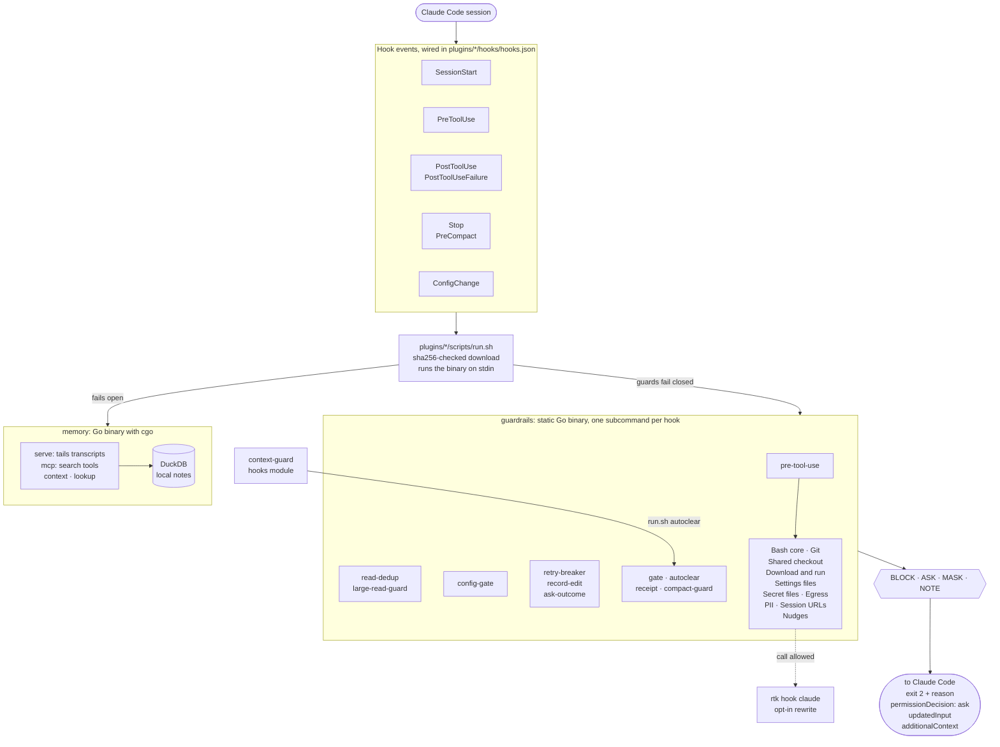

# broodhall

[](https://github.com/jj-scoll/broodhall/actions/workflows/ci.yml?query=branch%3Amain) [](https://jj-scoll.github.io/broodhall/reference/testing/) [](https://scorecard.dev/viewer/?uri=github.com/jj-scoll/broodhall)

A Claude Code marketplace with four plugins.

| Plugin | What it does | Needs | After install |
| --- | --- | --- | --- |
| guardrails | Blocks destructive shell commands, asks before destructive git and settings edits, masks Bash reads of secret files, blocks the Read tool on them and asks before writes to them, blocks oversized whole-file Reads, and notes re-reads and retry loops. | Linux or macOS on amd64 or arm64; `curl`, `tar`, and `sha256sum` or `shasum`. | Every guard family on. |
| memory | Keeps notes of your sessions in a local database and gives Claude search tools over them. | As guardrails, plus glibc 2.35 or newer and `xz` on Linux, and `claude` on `PATH`, signed in. | Records from the first session once the download lands. Context from the second. |
| context-guard | Runs the `/clear` at the end of the guardrails handoff chain, warns as the context grows, and blocks prompts past a limit. | guardrails (installed with it) and Claude Code 2.1.317 or newer. | On: warns at 180000 tokens, blocks at 260000. |
| rtk | Tells Claude how [rtk](https://github.com/jj-scoll/rtk)-condensed command output reads. | rtk from the jj-scoll fork on `PATH`. | The session-start note is on. The command rewrite is off until you turn on the guardrails `rtk` option. |

The guardrails hooks are one static Go binary, also named `guardrails` (in older releases,
`claude-tools`). Its config and state directories are `~/.config/guardrails` and
`~/.local/state/guardrails`, and its environment variables are `GUARDRAILS_*`. Files you
already have under `~/.config/claude-tools` or `~/.local/state/claude-tools` keep being used,
and a `CLAUDE_TOOLS_*` variable still works while its `GUARDRAILS_*` name is unset (see
[Options](docs/guardrails/options.md#older-names)). memory has no `/plugin configure` options; it reads environment variables and an optional
settings file instead.

## Quick start

1. Add the marketplace: `claude plugin marketplace add jj-scoll/broodhall`
2. Enable the plugins: `claude plugin install guardrails@broodhall`, and any of `memory`,
   `context-guard` and `rtk` the same way.
3. Start a new session and run `/guardrails:setup`. It lets you pick a profile and enter your
   email domains, shows what it will write, runs `guardrails doctor`, and offers a harmless
   demo of a block. It is safe to run again.

The command is `/guardrails:setup`, not `/broodhall:setup`: a plugin's commands take the
plugin's name, and broodhall is the marketplace.

To set up a whole team or organisation at once, see
[Roll out to a team](https://jj-scoll.github.io/broodhall/guide/team/).

## Install

```sh
claude plugin marketplace add jj-scoll/broodhall
claude plugin install guardrails@broodhall
claude plugin install memory@broodhall
claude plugin install context-guard@broodhall
claude plugin install rtk@broodhall
```

Install only the ones you want. Start a new session afterwards.

The install of guardrails and context-guard says that some `userConfig` options are not set
yet. That is expected: the defaults apply until you change them.

If a broken binary blocks every tool call, run `claude plugin disable guardrails@broodhall`
in a terminal and start a new session.

Documentation: https://jj-scoll.github.io/broodhall/

Threat model: [THREAT_MODEL.md](THREAT_MODEL.md) maps each guard to the OWASP Top 10 for LLM
Applications and MITRE ATLAS, with an attack test for every threat.

## Architecture

Claude Code fires hook events; each plugin's `hooks/hooks.json` sends them to its
`scripts/run.sh` launcher, which checks the release binary's sha256 and runs it on the hook's
JSON. The guardrails binary answers with a decision: BLOCK, ASK, MASK or NOTE.



More on each piece: [Architecture](https://jj-scoll.github.io/broodhall/reference/architecture/).

## Tests

`go test ./...` covered 85.1% of statements when this was written (guardrails 88.9%, memory
82.1%), over 33,080 lines of Go and 26,003 lines of Go tests. The badge above has the current
figure: it is re-measured on every docs deploy from `main`. Beyond unit tests there are:

- hook end-to-end tests that feed Claude Code's JSON to a hook on stdin and check its exit
  code, stdout and stderr;
- a frozen corpus of commands and the decision each must get;
- an attack test for every threat in [THREAT_MODEL.md](THREAT_MODEL.md), plus tests that pin
  each admitted bypass as still open;
- shell suites for the `run.sh` launchers: failed download, checksum mismatch, crashing or hung
  binary.

```sh
CGO_ENABLED=0 go test ./cmd/guardrails/...                  # guardrails, no setup
MEMORY_EXT_DIR=/path/to/ext go test ./... -coverprofile=cover.out
bash plugins/guardrails/test/run_test.sh                    # launcher suites, as CI runs them
```

See [Tests and coverage](https://jj-scoll.github.io/broodhall/reference/testing/) for the
per-package numbers and every suite CI runs.

## License

MIT
