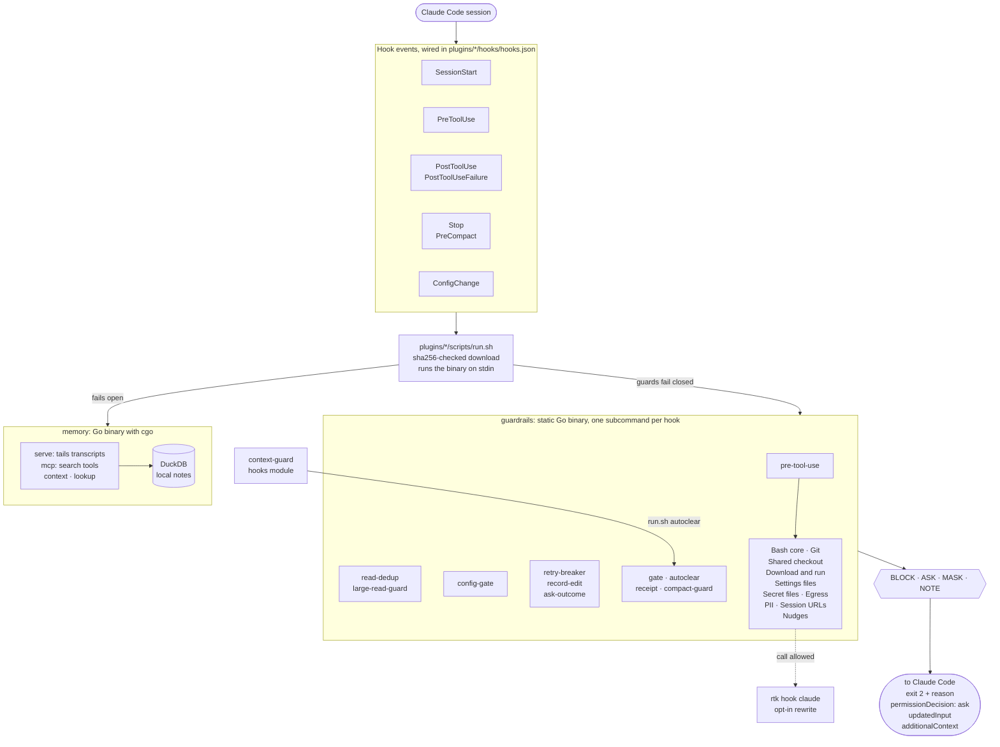

# Architecture

broodhall is a Claude Code plugin marketplace. Claude Code fires hook events, and each
plugin's `hooks/hooks.json` turns them into shell commands. Every command goes through the
plugin's `scripts/run.sh` launcher, which runs a Go binary on the hook's JSON input. The
binary's exit code and stdout carry the decision back to Claude Code.

## The pieces

| Piece | Code | What it is |
| --- | --- | --- |
| Hook wiring | `plugins/<name>/hooks/hooks.json` | Which event and tool matcher runs which subcommand. The full table is on [Hooks](hooks.md). |
| Launcher | `plugins/<name>/scripts/run.sh` | POSIX `sh`. Downloads the release binary for this plugin version, checks its sha256 against the `checksums.txt` that the release commit pins in the plugin directory (so replacing the release's files is not enough to change it), and runs it on the hook's stdin. It never runs a binary that failed the check. |
| guardrails | `cmd/guardrails` | One static Go binary (`CGO_ENABLED=0`). `main.go` maps each subcommand name to a function; each hook calls one subcommand. |
| memory | `cmd/memory` | A Go binary built with cgo for DuckDB. `memory serve` is a background daemon that tails session transcripts and writes notes to a local DuckDB database; `memory mcp` serves search tools to Claude over MCP. |
| context-guard | `plugins/context-guard/hooks/context-guard.mjs` | A Claude Code hooks module, not a command hook. It runs the `/clear` that guardrails' `autoclear` arms, and warns or blocks as the context grows. |
| rtk | external, [jj-scoll/rtk](https://github.com/jj-scoll/rtk) | Condenses command output. With the guardrails `rtk` option on, `pre-tool-use` runs `rtk hook claude` itself, after its own guards. |

## A tool call through guardrails

1. Claude Code sends the PreToolUse event for a Bash call to `run.sh pre-tool-use` as JSON on
   stdin.
2. `run.sh` finds this version's binary. If it is missing it uses the newest older one and
   starts the download. If there is none at all it exits 2, so the call is blocked rather
   than let through unguarded (unless you turned on the `fail_open` option).
3. `guardrails pre-tool-use` parses the command with a shell parser and runs the guard
   families in order. The first guard that blocks or asks decides.
4. The answer goes back the way Claude Code reads it:

    | Decision | How the hook says it |
    | --- | --- |
    | BLOCK | Exit code 2, with the reason on stderr. Claude sees the reason. |
    | ASK | `permissionDecision: "ask"` in the JSON on stdout. You approve or refuse. |
    | MASK | `updatedInput` with the command rewritten to run through the secret or PII redactor. |
    | NOTE | `additionalContext`: a short note for Claude next to the tool result. |

5. If no guard objects and the `rtk` option is on, the hook hands the call to `rtk hook claude`
   and passes its rewrite back.

The guards are described one by one under [Guardrails](../guardrails/index.md). The
[threat model](threat-model.md) maps each one to the attack it stops, with a test for each.

## Failure behaviour

| Plugin | When its binary is missing, crashes or hangs |
| --- | --- |
| guardrails | The guards (`pre-tool-use`, `read-dedup`, `large-read-guard`, `config-gate`) fail closed: exit 2 and the tool call is blocked. Their `hooks.json` entries also set `onFailure: block`. Every other hook exits 0, so a broken binary never stops a session from ending or compacting. |
| memory | Fails open: the launcher always exits 0, prints nothing on failure, and kills the binary after a timeout. |
| context-guard | Prints nothing and does nothing when it finds no guardrails state or binary. |
